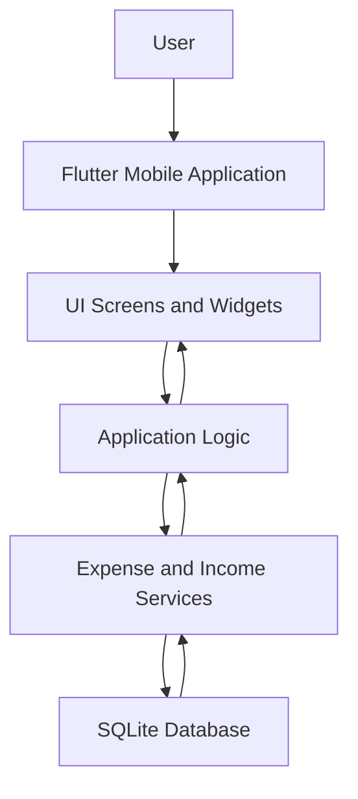
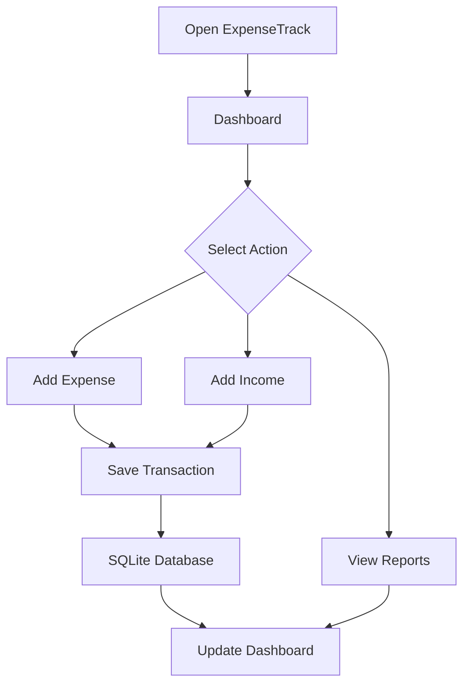

# ExpenseTrack – Personal Expense Tracker Mobile Application


## Overview

ExpenseTrack is a personal finance management mobile application developed using Flutter and Dart. It helps users record daily expenses, manage income, categorize transactions, and monitor their spending habits.

The application provides a simple interface for tracking financial activities and understanding how money is spent over time.

Flutter is used to develop the mobile application, Dart handles application logic, and SQLite can be used for local data storage.

## Key Features

### Expense Management
- Add new expenses.
- Enter expense descriptions and amounts.
- Select expense categories.
- Record transaction dates.
- View previously recorded expenses.
- Edit and delete expense records.

### Income Management
- Record income transactions.
- Enter income descriptions and amounts.
- View income history.
- Track total income.

### Category Management
- Organize transactions into categories.
- View expenses by category.
- Identify major spending areas.

Example categories:
- Food
- Transportation
- Shopping
- Education
- Healthcare
- Entertainment
- Bills and Utilities

### Dashboard
- Display total income.
- Display total expenses.
- Calculate available balance.
- View recent transactions.
- Monitor spending patterns.

### Reports and Insights
- View expense summaries.
- Analyze spending by category.
- Track monthly expenses.
- Compare income and expenditure.

## Technology Stack

| Category | Technologies |
|---|---|
| Mobile Framework | Flutter |
| Programming Language | Dart |
| Database | SQLite |
| Local Storage | SQLite / Shared Preferences, if implemented |
| Development Environment | Android Studio, VS Code |
| UI Development | Flutter Widgets |
| Version Control | Git and GitHub |

## Application Architecture



## Project Structure

```text
ExpenseTrack/
│
├── lib/
│   ├── main.dart
│   │
│   ├── screens/
│   │   ├── home_screen.dart
│   │   ├── add_expense_screen.dart
│   │   ├── expense_list_screen.dart
│   │   ├── income_screen.dart
│   │   └── reports_screen.dart
│   │
│   ├── models/
│   │   ├── expense.dart
│   │   └── income.dart
│   │
│   ├── services/
│   │   └── database_service.dart
│   │
│   ├── widgets/
│   │   └── transaction_card.dart
│   │
│   └── utils/
│
├── assets/
├── test/
├── pubspec.yaml
└── README.md
```

*This is an illustrative structure. Use the actual filenames from your project.*

## Database Design

The application can use SQLite tables to store financial records.

### Expense Table

| Field | Description |
|---|---|
| id | Unique expense ID |
| title | Expense title |
| amount | Expense amount |
| category | Expense category |
| date | Transaction date |
| description | Additional details |

### Income Table

| Field | Description |
|---|---|
| id | Unique income ID |
| title | Income title |
| amount | Income amount |
| date | Income transaction date |
| description | Additional details |

## Application Workflow



## Installation and Setup

### Prerequisites

- Flutter SDK
- Dart SDK
- Android Studio or Visual Studio Code
- Android Emulator or physical Android device
- Git

### 1. Clone the Repository

```bash
git clone https://github.com/YOUR-USERNAME/ExpenseTrack.git
cd ExpenseTrack
```

### 2. Install Dependencies

```bash
flutter pub get
```

### 3. Check Flutter Setup

```bash
flutter doctor
```

Resolve any required Android SDK or device configuration issues.

### 4. Run the Application

```bash
flutter run
```

The application will launch on the selected emulator or connected mobile device.

## Testing

Run Flutter tests using:

```bash
flutter test
```

Testing can cover:
- Expense creation.
- Income creation.
- Transaction editing and deletion.
- Category selection.
- Balance calculations.
- Database operations.

Only describe tests as completed if they have actually been implemented and executed.

## Future Enhancements

- Monthly and yearly financial reports.
- Interactive spending charts.
- Budget creation and tracking.
- Expense reminders.
- Export reports to PDF or CSV.
- Cloud synchronization.
- User authentication.
- Data backup and restoration.

## Skills Demonstrated

- Flutter mobile application development
- Dart programming
- Mobile UI development
- SQLite database integration
- CRUD operations
- Data management
- Financial calculations
- Application testing
- Mobile application architecture

## Conclusion

ExpenseTrack demonstrates how Flutter and Dart can be used to develop a personal finance management application. It focuses on recording transactions, organizing financial information, and presenting useful spending summaries through a mobile interface.
